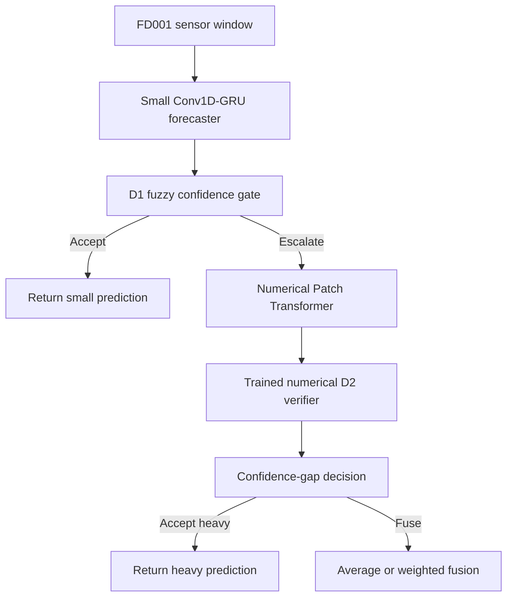

# SAGE — Selective Agentic Gating with Evaluation for Remaining Useful Life Prediction

**A research framework for evaluating selective routing between lightweight and heavy forecasting models on NASA C-MAPSS FD001.**

[](LICENSE)
[](#installation)

> **Research focus:** SAGE investigates whether a learned gate can decide when a lightweight forecaster should be retained and when a more computationally demanding forecaster should be invoked. The central question is not whether the heavy model is always better; it is whether the gate can identify, for an individual engine, when escalation is likely to improve the prediction.

> **Main finding:** In the reported five-seed FD001 evaluation, selective SAGE reduced heavy-path usage to 25%, but its routing decisions did not reliably select the lower-error predictor. Unconditional arithmetic averaging achieved the lowest reported mean RMSE. The results expose a key distinction: estimating the small model's error is not the same as estimating the *incremental benefit of escalation*.

---

## Contents

- [Research Question and Contribution](#research-question-and-contribution)
- [At-a-Glance Results](#at-a-glance-results)
- [Gate-Effectiveness Analysis](#gate-effectiveness-analysis)
- [Architecture](#architecture)
- [Experimental Protocol](#experimental-protocol)
- [Data Integrity and Evaluation Limitations](#data-integrity-and-evaluation-limitations)
- [Repository Layout](#repository-layout)
- [Installation](#installation)
- [Reproducing the Experiments](#reproducing-the-experiments)
- [Tests and Continuous Integration](#tests-and-continuous-integration)
- [Interpreting and Citing the Results](#interpreting-and-citing-the-results)
- [Limitations](#limitations)
- [Citation and License](#citation-and-license)

---

## Research Question and Contribution

**Can a learned gate intelligently choose between a small forecaster and a heavy forecaster while balancing prediction accuracy and computational utilization?**

SAGE studies selective forecasting for turbofan-engine Remaining Useful Life (RUL) estimation.

A lightweight forecaster handles cases judged suitable for an early exit. Cases rejected by the gate are sent to a heavier forecasting path. A verifier and decision rule are designed to assess the heavy prediction and select either the heavy output or a fused prediction.

The journal study evaluates the *decision quality* of this routing strategy. In particular, it examines:

1. Whether the gate's decisions agree with a retrospective oracle that selects whichever forecaster has lower realized error.
2. How often the gate escalates and how often it misses cases where the heavy model would have been better.
3. The prediction error and heavy-path utilization produced by selective routing compared with fixed-model and unconditional-fusion alternatives.
4. Whether the observed routing behaviour is consistent across five random seeds.

The principal finding is negative for the evaluated gate configuration: it reduces heavy-path utilization, but does not reliably identify when escalation is beneficial. This is reported as an empirical result, not hidden or reframed as a performance gain.

## At-a-Glance Results

The following results are reported for the **60-engine FD001 evaluation subset identified as clean by the project leakage audit**, across five seeds (42–46).

RMSE and MAE are in RUL cycles. The displayed `±` values are the reported across-seed variation; consult the manuscript and result artifacts for the engine-clustered bootstrap intervals and their exact construction.

| Variant | RMSE ↓ | MAE ↓ | Heavy-path calls |
|---|---:|---:|---:|
| `small_only` | 15.21 ± 0.63 | 10.61 | 0% |
| `numerical_heavy` | 13.67 ± 0.51 | 10.10 | 100% |
| `numerical_sage` (D1 + numerical D2) | 14.66 ± 0.70 | 10.54 | 25% |
| `sage_weighted` | 14.62 ± 0.70 | 10.48 | 25% |
| `always_average` | **13.48 ± 0.44** | **9.81** | 100% |

### How to Read These Results

- `numerical_sage` reduces heavy-path use to approximately one quarter of evaluated cases.
- Its reported mean RMSE is lower than `small_only`, but higher than `numerical_heavy` and `always_average`.
- `always_average` has the lowest reported RMSE and MAE in this comparison, but invokes the heavy predictor for every case.
- The current results therefore show a utilization reduction, not a demonstrated accuracy advantage over unconditional fusion or the numerical-heavy model.
- The findings apply to the evaluated FD001 protocol and implementations. They should not be generalized to every selective-prediction method, every LLM, or every industrial RUL task.

## Gate-Effectiveness Analysis

The gate-effectiveness evaluation compares SAGE's per-engine routing decision with a retrospective oracle decision.

The oracle chooses the forecaster with lower realized error after the true RUL is known. It is therefore an **evaluation reference only**, not a deployable inference-time policy.

| Gate Metric | Five-Seed Result |
|---|---:|
| Oracle agreement | 37.0% ± 9.7% |
| False escalation rate | 8.7% ± 7.8% |
| Missed escalation rate | 37.3% ± 15.1% |
| Selection regret relative to oracle | +2.55 ± 0.20 RMSE points |

These metrics are reported as mean ± standard deviation across seeds. The corresponding per-seed calculations and metric definitions are maintained in the gate-effectiveness evaluation artifacts and `gate_effectiveness_eval.py`.

**Interpretation:** The gate's current confidence target is based on the small forecaster's prediction error. A sample that is difficult for the small model is not necessarily a sample on which the heavy model is more accurate. The low oracle agreement and positive selection regret indicate that the gate does not yet estimate escalation utility reliably.

The oracle uses realized outcomes and is unavailable at prediction time. Its purpose is to quantify the gap between the learned policy and an idealized per-instance choice, not to represent a practical baseline that can be deployed.

## Architecture

### Main Components

| Component | Role |
|---|---|
| **Small forecaster (S)** | Conv1D–GRU model that maps a 50-cycle, 14-sensor window to an RUL estimate and temporal features. |
| **D1 fuzzy gate** | Estimates a quality score for the small prediction and decides whether to accept it or escalate. |
| **Numerical heavy path** | Patch Transformer forecasting model used in the five-seed journal experiments. |
| **Numerical D2 verifier** | Trained verifier for numerical heavy-path representations; it estimates the quality of the heavy prediction. |
| **Decision and fusion** | Applies the confidence-gap decision and selects a heavy output or a configured fusion of small and heavy predictions. |
| **LLM-agent path** | Separate four-agent interface (`Context → Macro → Micro → Synthesis`), retained in the codebase but not the heavy path used for the reported numerical five-seed results. |

### Selective-Routing Workflow



### Numerical D2 versus Semantic LLM D2

The five-seed journal results evaluate **numerical D2**, trained on representations from the numerical Patch Transformer.

The repository also contains a separate LLM four-agent pipeline and a semantic-verifier design based on text representations of agent traces.

The numerical D2 results do **not** validate the semantic LLM-trace verifier. Keep these configurations separate when interpreting results, reproducing experiments, or citing the paper.

## Experimental Protocol

The reported journal workflow uses NASA C-MAPSS FD001 with:

- 14 sensor channels.
- Sliding windows of length 50.
- Stride of one.
- RUL labels capped at 125 cycles.
- Sensor-scaling statistics fitted using the fit partition only and applied to other partitions.

### FD001 Dataset Partitions

| Partition | Windows | Engines | Role |
|---|---:|---:|---|
| Fit | 9,370 | 60 | Small-model fitting |
| Confidence | 3,237 | 20 | Confidence/gate supervision |
| Validation | 3,124 | 20 | Development and threshold selection |
| Official test | 100 | 100 | Original official test partition |
| **Non-test total** | **15,731** | — | Fit + confidence + validation |
| **Grand total** | **15,831** | — | Non-test + official test |

The journal workflow trains and evaluates five seeds (42, 43, 44, 45, 46).

Threshold tuning is performed on validation data, and the final reported evaluation uses the 60-engine subset identified as clean in the project's leakage audit.

## Data Integrity and Evaluation Limitations

A previous gate-calibration diagnostic exposed 40 of the 100 official FD001 test engines. Those exposed engines are excluded from the final evaluation.

The project records the 60-engine evaluation manifest at:

```text
runs/gate-final-audit/clean_test_engines.json
```

The reported final test results use the engines in this manifest.

Do not expand the final evaluation to the exposed engines, and do not use final test labels for training, threshold tuning, model selection, or other development decisions.

The validation partition was reused during earlier development and is therefore not an untouched model-selection set. This limitation remains relevant when interpreting generalization.

See [`paper/limitations.md`](paper/limitations.md), the manuscript, and the reproducibility checklist for the complete data-integrity discussion.

## Repository Layout

The lean release keeps the core implementation, journal experiment scripts, tests, prepared FD001 data, final experiment artifacts, and paper-support files.

Historical caches, temporary backups, unrelated prepared tracks, and raw source datasets are not part of the lean release.

```text
SAGE/
├── sage/                         # Core SAGE package
│   ├── forecaster/               # Conv1D–GRU small forecaster
│   ├── gate/                     # Fuzzy D1 gate
│   ├── heavy/                    # Numerical heavy model and LLM-agent interface
│   ├── verify/                   # D2 verifier, decision, and fusion
│   ├── data/                     # Dataset preparation and preprocessing
│   ├── pipeline.py               # Pipeline orchestration
│   ├── cli.py                    # CLI entry point
│   ├── inference.py              # Single-sample inference
│   └── trace.py                  # Execution tracing
├── train/                        # Shared training implementation
├── eval/                         # Benchmarking and threshold tuning
├── tests/                        # 37 software tests
├── data/
│   └── prepared-fd001/            # Prepared FD001 data used by journal workflow
├── runs/
│   ├── journal-training/          # Five-seed model checkpoints
│   ├── journal-eval/              # Clean-test predictions and metrics
│   ├── journal-tuning/            # Validation-based threshold tuning
│   └── gate-final-audit/          # Clean-test engine manifest
├── paper/                         # Manuscript and supporting research documents
├── train_journal.py               # Five-seed journal training
├── eval_journal.py                # Clean-test evaluation
├── tune_journal.py                # Validation-only threshold tuning
├── gate_effectiveness_eval.py     # Oracle-based routing analysis
├── verify_metrics.py              # Metrics verification utilities
├── generate_docx.py               # DOCX manuscript generation
├── generate_pdf.py                # PDF manuscript generation
├── pyproject.toml                 # Package metadata and CLI entry point
├── requirements.txt               # Python dependencies
├── CITATION.cff                   # Citation metadata
└── README.md
```

## Installation

The project is configured for Python 3.11 and 3.12 in continuous integration. A virtual environment is recommended.

### Windows PowerShell

```powershell
git clone https://github.com/yuvrajrajpurohit01/SAGE.git
cd SAGE

py -3.11 -m venv .venv
.\.venv\Scripts\Activate.ps1

python -m pip install --upgrade pip
python -m pip install -e .
```

If the repository is private, authenticate with GitHub before cloning.

To use Python 3.12, replace `py -3.11` with `py -3.12`.

### Linux / macOS

```bash
git clone https://github.com/yuvrajrajpurohit01/SAGE.git
cd SAGE

python3.11 -m venv .venv
source .venv/bin/activate

python -m pip install --upgrade pip
python -m pip install -e .
```

The project uses PyTorch, NumPy, and pandas for the numerical workflow.

The editable installation uses the dependency declarations in `pyproject.toml` and `requirements.txt`; keep those files synchronized when changing dependencies.

## Reproducing the Experiments

The principal five-seed journal experiments use the **numerical heavy path** and do not require paid LLM API calls.

Run the stages in order. Do not tune thresholds on the final test subset.

### 1. Prepare FD001 Data

Raw NASA C-MAPSS files are not included in the lean release.

Obtain the FD001 source files from the appropriate NASA C-MAPSS distribution and place them in `data/CMAPSS/` using the filenames expected by the data-preparation code.

Then run:

```powershell
python -m sage.cli prepare --track FD001 --source data/CMAPSS --output data/prepared-fd001
```

The prepared FD001 data used by the journal workflow is retained under `data/prepared-fd001/` in the release.

If using that prepared data, this preparation step can be skipped.

Check the dataset's own terms and attribution requirements before redistributing source files.

### 2. Train the Five-Seed Journal Models

```powershell
python train_journal.py
```

The journal workflow uses seeds 42–46.

Checkpoints and training artifacts are written under:

```text
runs/journal-training/
```

### 3. Tune Thresholds on Validation Data

```powershell
python tune_journal.py
```

Thresholds must be selected using validation data only.

The recorded tuning output is stored under:

```text
runs/journal-tuning/
```

### 4. Evaluate on the Verified-Clean Test Subset

```powershell
python eval_journal.py
```

Evaluation outputs are written under:

```text
runs/journal-eval/
```

The clean-engine manifest is:

```text
runs/gate-final-audit/clean_test_engines.json
```

Keep the final evaluation protocol frozen; do not use test results to adjust thresholds or select models.

### 5. Analyse Routing Effectiveness

```powershell
python gate_effectiveness_eval.py
```

This evaluates per-engine routing against the retrospective oracle and reports:

- Oracle agreement.
- False escalation.
- Missed escalation.
- Selection regret.

Because the oracle requires realized outcomes, it is an analysis reference and cannot be used as an inference-time gate.

### 6. Verify Reported Metrics

```powershell
python verify_metrics.py
```

### 7. Generate Manuscript Files

```powershell
python generate_docx.py
python generate_pdf.py
```

Inspect the generated documents before submission.

In particular, verify figures, equations, references, page breaks, and agreement between manuscript tables and the saved experiment outputs.

## Tests and Continuous Integration

Run the test suite from the repository root after activating the virtual environment:

```powershell
python -m unittest discover -s tests -v
```

The reported suite contains **37 tests** across four test modules.

The GitHub Actions workflow is configured for Python 3.11 and 3.12.

Check the repository's Actions tab for the status of the latest remote workflow run. A local pass does not by itself confirm that both CI environments have passed.

The tests verify software behaviour and selected implementation invariants. They do not independently establish predictive validity, gate effectiveness, or generalization beyond the evaluated protocol.

## Interpreting and Citing the Results

The reported table and gate metrics should be interpreted together:

- **Prediction metrics:** RMSE and MAE measure forecast error.
- **Heavy-call rate:** Measures utilization of the heavy path.
- **Oracle agreement:** Measures agreement with the retrospective lower-error model choice.
- **False escalation and missed escalation:** Characterize the two directions of routing error, using the definitions implemented in the analysis code.
- **Selection regret:** Measures the loss relative to the retrospective oracle reference under the implementation's stated definition.

Oracle agreement is not ordinary classification accuracy against a pre-existing class label: the preferred model is determined retrospectively from the realized errors on each evaluated engine.

The exact metric definitions and denominator conventions should be taken from `gate_effectiveness_eval.py` and the corresponding experiment report.

For the full scientific account, see the manuscript and supporting materials under `paper/`, especially:

- [`paper/claims_evidence_matrix.md`](paper/claims_evidence_matrix.md) — claims linked to supporting evidence.
- [`paper/reproducibility_checklist.md`](paper/reproducibility_checklist.md) — reproduction requirements and artifact inventory.
- [`paper/limitations.md`](paper/limitations.md) — threats to validity and known limitations.
- [`paper/tables/tables.md`](paper/tables/tables.md) — research tables.
- [`paper/figures/figures.md`](paper/figures/figures.md) — figure inventory and descriptions.

## Limitations

1. **Routing objective:** D1 is supervised to estimate small-model prediction quality. That target does not directly estimate the incremental value of escalating to the heavy model.

2. **Decision quality:** The reported oracle agreement and missed-escalation results indicate that the current gate does not reliably select the lower-error forecaster.

3. **Fusion comparison:** Unconditional arithmetic averaging achieved the lowest reported mean RMSE in the five-seed comparison. Selective routing did not outperform it.

4. **Dataset scope:** The journal experiments focus on NASA C-MAPSS FD001. Further datasets and operating conditions are required to establish broader generalization.

5. **Test-set exposure:** Forty official test engines were exposed during an earlier diagnostic and are excluded from the final 60-engine evaluation subset.

6. **Validation reuse:** Validation data informed earlier development and threshold exploration; it is not an untouched development-independent test set.

7. **D2 scope:** The numerical D2 verifier is evaluated in the journal experiments. The semantic verifier based on LLM-agent text traces is not validated by these numerical results.

8. **LLM path:** The four-agent LLM pipeline remains a separate implementation. The numerical five-seed results do not establish the accuracy or cost-effectiveness of the LLM-based heavy path.

The paper's conclusion is intentionally bounded: SAGE demonstrates an implemented selective-routing framework and provides empirical evidence that the present confidence objective does not reliably estimate escalation benefit in the evaluated FD001 setting.

## Citation and License

If you use this work, cite the project using the metadata in [`CITATION.cff`](CITATION.cff).

The repository's citation metadata should be updated when a versioned release or DOI is created.

The source code is distributed under the [MIT License](LICENSE), subject to the ownership and licensing terms of all included components.

Dataset redistribution rights and third-party model/dependency licenses are separate and must be respected.

## Questions and Contributions

For questions about the implementation or reported experiments, use the repository's issue tracker when available.

Include the relevant commit, Python version, command, configuration, and a minimal reproduction example.

Never include API keys, credentials, private datasets, or sensitive logs in an issue.
